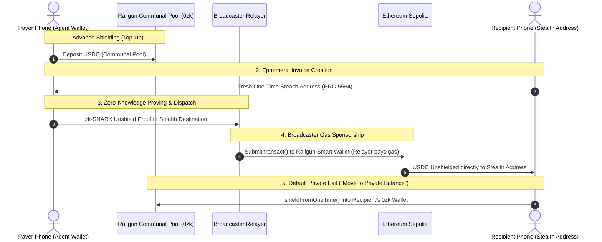

# CPay ("See-Pay")

Smart glasses for private, hands-free payments: look at a QR or face, say *"pay 2 USDC"*, then say the confirm code only you can see.

> **"Your face picks you out but never identifies you."**

---

## Network & Privacy Details (Ethereum Sepolia)

CPay operates on **Ethereum Sepolia** using the official, canonical **Railgun Smart Wallet** zero-knowledge pool combined with **ERC-5564 stealth addresses**:

* **Network Name**: Ethereum Sepolia
* **Chain ID**: `11155111`
* **RPC Endpoint**: `https://ethereum-sepolia-rpc.publicnode.com`
* **Block Explorer**: [https://sepolia.etherscan.io](https://sepolia.etherscan.io)
* **Circle USDC (Sepolia)**: `0x1c7D4B196Cb0C7B01d743Fbc6116a902379C7238`
* **Official Railgun Smart Wallet**: `0xecfcf3b4ec647c4ca6d49108b311b7a7c9543fea`

---

## Privacy Architecture: Dual-Sided Anonymity

CPay achieves complete **dual-sided anonymity** by combining **Railgun zero-knowledge shielded pools** with **ERC-5564 stealth addresses**. On a public blockchain, standard payments leak the identity of both parties: the payer's wallet is permanently recorded as `tx.origin` / `msg.sender`, and the recipient's static address is exposed. CPay breaks both sides of this graph.



### 1. How Railgun ZK Operates on Top of Stealth Addresses

1. **Payer Hidden by Railgun**:
   * The payer pre-funds their private balance ahead of time by depositing USDC into Railgun's canonical zero-knowledge contract (`0xecfcf3b4ec647c4ca6d49108b311b7a7c9543fea`).
   * When a payment is initiated, funds unshield directly from the communal anonymity pool using a client/server-generated zk-SNARK proof.
   * Because funds originate from the collective Railgun pool, on-chain observers cannot determine which shield deposit corresponds to the payment.

2. **Recipient Hidden by Stealth One-Time Addresses**:
   * For each payment, the recipient's device generates a fresh, single-use, unlinkable **ERC-5564 stealth address** derived locally from their stealth keys.
   * The Railgun unshield transaction delivers USDC directly to this ephemeral one-time address.
   * The recipient's true identity, public ENS, or static wallet address is never revealed on-chain or shared with the payer.

3. **Broadcaster Gas Sponsorship (No Payer On-Chain Footprint)**:
   * The unshield transaction is broadcast to the network by an independent **Broadcaster relayer** (`/api/railgun/broadcast`).
   * The Broadcaster relayer pays on-chain gas fees and submits the transaction. It may also send a bounded gas drop (maximum 0.001 ETH) to the recipient's one-time address so the recipient can shield funds back into Railgun.
   * **The payer's agent wallet never signs payment transactions on-chain, never pays gas, and never appears as `from`, `sender`, or `tx.origin`**.
   * If configured, the recipient gas drop is dispatched via the Broadcaster relayer.

4. **Default Privacy Exit: "Move to Private Balance"**:
   * In CPay's Private Balance UI, recipients manage funds received across their one-time stealth addresses.
   * Funds move into Railgun through **"🛡️ Move to private balance"** (`shieldOneTimeToRailgun` / `shieldFromOneTime`). There is no direct sweep-to-agent action in the app.
   * This executes an approval and `shield()` transaction directly from the one-time stealth address into the recipient's personal Railgun `0zk` shielded wallet.
   * The funds re-enter the communal zero-knowledge pool. Amounts and timing remain visible at the shield and unshield boundaries, so this does not guarantee unlinkability.

---

## Information Asymmetry: What Participants Learn

CPay limits data shared with network intermediaries. The browser generates proofs and scans balances locally; transaction amounts remain public at pool boundaries:

| Network Actor | What They Learn (Can See) | What Stays Private (Cannot See) |
| :--- | :--- | :--- |
| **Broadcaster (Relayer)** | • Recipient destination and gas-drop amount<br>• Proved transaction payload, which contains the public unshield destination and amount | • Railgun mnemonic, spending key, viewing key, and note history (proof generation and scanning run in the browser) |
| **POI (Proof of Innocence)** | • Cryptographic membership verification confirming that unshielded funds originate from clean, non-sanctioned deposits | • User's specific deposit identity or commitment index<br>• Spending path and counterparties<br>• Account balance or historical transaction graph |
| **RPC Node & On-Chain Observers** | • Public top-up shields and unshield disbursements, including amounts and timing; the broadcaster address and recipient destination are public<br>• IP address of the node caller | • Railgun's proof hides which note is spent, but matching amounts and timing can still support correlation; privacy is not a guarantee that payer and recipient cannot be linked |

**Current design:** the client generates the proof and submits only the populated transaction plus recipient and bounded gas-drop fields. The broadcaster accepts only `BROADCASTER_PRIVATE_KEY`, never the agent wallet key.

---

## Circuit Artifact Hosting Status

The SDK downloader normally points at an IPFS gateway. The browser rewrites those requests to `/api/railgun/artifacts/`; the web server fetches only pinned Railgun circuit CIDs and caches the files under its temporary directory. This keeps client traffic on the CPay origin, but the artifact bytes are not checked into `public/circuits/` and the upstream remains a server-side dependency.

* **Pinned source, same-origin client path**:
  * The API route allows only known Railgun circuit variants and pinned SDK CIDs; the server fetches upstream files and returns them through the app origin.
  * The browser's SDK requests use the app's hostname. The 2×2 WASM and zkey files were fetched through the route successfully; other variants and target-phone behavior still need validation.

* **Device cache**:
  * The browser `ArtifactStore` persists downloaded circuit files in IndexedDB and the browser SDK verifies artifact hashes before caching.
  * The server API also keeps a temporary-directory cache; ephemeral deployments may fetch the same pinned file again after restart.

* **Client proving is active; device validation remains**:
  * Proof generation and Railgun scanning run in the browser with IndexedDB storage. Target-phone scan persistence and proving performance have not been measured yet.

---

## Architecture Overview

* **Frontend**: Next.js App Router (PWA) with client-side face recognition and QR scanning (`jsQR`).
* **AI Brain & Voice**: **0G Private Computer** (`whisper-large-v3` for speech-to-text, `glm-5.3` / `qwen-flash` for intent extraction) inside hardware-isolated TEEs.
* **Identity & Sybil Resistance**: **World ID** Proof of Human (IDKit 4.0) + World Agent Pass (human-in-the-loop step-up) + BBS anonymous credentials.
* **Database**: **Supabase PostgreSQL** via Prisma (stores ONLY anonymous World ID nullifiers + issuer keys).
* **Settlement & Privacy**: **Ethereum Sepolia** via official Railgun Smart Wallet and one-time stealth addresses (`ERC-5564`).

---

## Quickstart

```bash
# 1. Install dependencies across the monorepo
pnpm install

# 2. Push Prisma database schema to Supabase
pnpm db:push

# 3. Start the Web App
pnpm --filter @cpay/web dev
# -> http://localhost:3000

# 4. Start the Issuer Backend (World ID verify & BBS)
pnpm --filter @cpay/issuer dev
# -> http://localhost:8788
```
