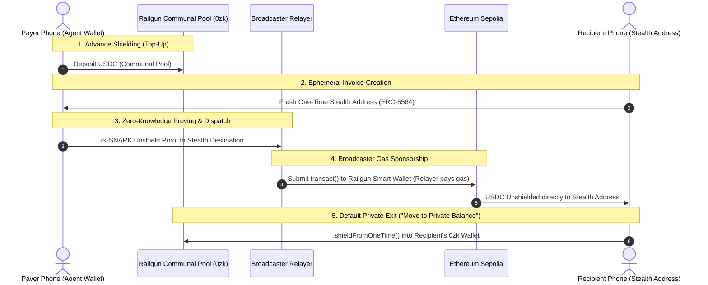

# CPay ("See-Pay")

Smart glasses for private, hands-free payments: look at a QR or face, say *"pay 2 USDC"*, then say the confirm code only you can see.

> **"Your face picks you out but never identifies you."**

---

## Network & Privacy Details (Ethereum Sepolia)

CPay operates on **Ethereum Sepolia** using the official, canonical **Railgun Smart Wallet** zero-knowledge pool combined with **ERC-5564 stealth addresses**:

* **Network Name**: Ethereum Sepolia
* **Chain ID**: `11155111`
* **RPC Endpoint**: `https://ethereum-sepolia-rpc.publicnode.com`
* **Block Explorer**: [https://sepolia.etherscan.io](https://sepolia.etherscan.io)
* **Circle USDC (Sepolia)**: `0x1c7D4B196Cb0C7B01d743Fbc6116a902379C7238`
* **Official Railgun Smart Wallet**: `0xecfcf3b4ec647c4ca6d49108b311b7a7c9543fea`

---

## Privacy Architecture: Dual-Sided Anonymity

CPay achieves complete **dual-sided anonymity** by combining **Railgun zero-knowledge shielded pools** with **ERC-5564 stealth addresses**. On a public blockchain, standard payments leak the identity of both parties: the payer's wallet is permanently recorded as `tx.origin` / `msg.sender`, and the recipient's static address is exposed. CPay breaks both sides of this graph.



### 1. How Railgun ZK Operates on Top of Stealth Addresses

1. **Payer Hidden by Railgun**:
   * The payer pre-funds their private balance ahead of time by depositing USDC into Railgun's canonical zero-knowledge contract (`0xecfcf3b4ec647c4ca6d49108b311b7a7c9543fea`).
   * When a payment is initiated, funds unshield directly from the communal anonymity pool using a client/server-generated zk-SNARK proof.
   * Because funds originate from the collective Railgun pool, on-chain observers cannot determine which shield deposit corresponds to the payment.

2. **Recipient Hidden by Stealth One-Time Addresses**:
   * For each payment, the recipient's device generates a fresh, single-use, unlinkable **ERC-5564 stealth address** derived locally from their stealth keys.
   * The Railgun unshield transaction delivers USDC directly to this ephemeral one-time address.
   * The recipient's true identity, public ENS, or static wallet address is never revealed on-chain or shared with the payer.

3. **Broadcaster Gas Sponsorship (No Payer On-Chain Footprint)**:
   * The unshield transaction is broadcast to the network by an independent **Broadcaster relayer** (`/api/railgun/broadcast`).
   * The Broadcaster relayer pays all on-chain gas fees and submits the transaction.
   * **The payer's agent wallet never signs payment transactions on-chain, never pays gas, and never appears as `from`, `sender`, or `tx.origin`**.
   * If a gas drop is needed for the recipient's one-time address, it is dispatched via the Broadcaster relayer, maintaining complete decoupling from the payer.

4. **Default Privacy Exit: "Move to Private Balance"**:
   * In CPay's Private Balance UI, recipients manage funds received across their one-time stealth addresses.
   * Rather than sweeping funds directly to their public agent wallet (which would link the ephemeral stealth address to their identity), the primary default action is **"🛡️ Move to private balance"** (`shieldOneTimeToRailgun` / `shieldFromOneTime`).
   * This executes an approval and `shield()` transaction directly from the one-time stealth address into the recipient's personal Railgun `0zk` shielded wallet.
   * The funds re-enter the communal zero-knowledge anonymity pool, breaking any link between the one-time receiving address and the recipient's long-term wallet. Sweeping directly to the agent wallet is gated behind an explicit public-linkage security warning.

---

## Information Asymmetry: What Participants Learn

CPay enforces strict cryptographic minimization across all network intermediaries:

| Network Actor | What They Learn (Can See) | What Stays Private (Cannot See) |
| :--- | :--- | :--- |
| **Broadcaster (Relayer)** | • Recipient destination (one-time stealth address)<br>• Token contract (Circle USDC) and payment amount<br>• Opaque zk-SNARK proof payload to broadcast on-chain | • Payer's Railgun `0zk` public address<br>• Payer's spending key and viewing key<br>• Payer's transaction history and internal note preimages<br>• Remaining balance inside the Railgun pool |
| **POI (Proof of Innocence)** | • Cryptographic membership verification confirming that unshielded funds originate from clean, non-sanctioned deposits | • User's specific deposit identity or commitment index<br>• Spending path and counterparties<br>• Account balance or historical transaction graph |
| **RPC Node & On-Chain Observers** | • Public on-chain activity: incoming shield deposits into the Railgun pool and unshield disbursements executed by Broadcasters to destination addresses<br>• IP address of the node caller (mitigated by server proxying) | • Cannot link which shield deposit belongs to which unshield withdrawal<br>• Cannot link payer to recipient<br>• Cannot decrypt Railgun pool internal balances, nullifiers, or encrypted note bundles |

---

## Self-Hosted Circuit Caching (Invariant 10)

In strict compliance with **CPay Invariant 10** ("No third-party trackers, analytics, CDNs, or fonts; models and WASM are self-hosted"):

* **Zero IPFS / Third-Party CDN Dependencies**:
  * Traditional zero-knowledge web applications often fetch circuit `.wasm` and `.zkey` artifacts dynamically from IPFS gateways, Cloudflare, or third-party artifact repositories. This exposes user IP addresses, introduces CDN downtime risks, and compromises censorship resistance.
  * CPay eliminates all third-party dependencies by serving and caching all zero-knowledge circuit artifacts locally.

* **Local Filesystem ArtifactStore**:
  * In `apps/web/lib/railgun-server.ts`, Railgun's engine is initialized with a custom, filesystem-backed `ArtifactStore` caching circuits in `circuits-cache/`.
  * The SDK loads circuit keys and WebAssembly binaries directly from local disk storage or the self-hosted origin server.

* **Origin-Hosted Circuit Manifest**:
  * Static circuit definitions (`shield.wasm`, `shield.zkey`, `unshield.wasm`, `unshield.zkey`, `transact.wasm`, `transact.zkey`) are declared in `apps/web/public/circuits/circuits.json` with `"selfHosted": true` and `"thirdPartyCdnDisabled": true`.
  * Prover computations run locally using `snarkjs.groth16` without external dependencies.

---

## Architecture Overview

* **Frontend**: Next.js App Router (PWA) with client-side face recognition and QR scanning (`jsQR`).
* **AI Brain & Voice**: **0G Private Computer** (`whisper-large-v3` for speech-to-text, `glm-5.3` / `qwen-flash` for intent extraction) inside hardware-isolated TEEs.
* **Identity & Sybil Resistance**: **World ID** Proof of Human (IDKit 4.0) + World Agent Pass (human-in-the-loop step-up) + BBS anonymous credentials.
* **Database**: **Supabase PostgreSQL** via Prisma (stores ONLY anonymous World ID nullifiers + issuer keys).
* **Settlement & Privacy**: **Ethereum Sepolia** via official Railgun Smart Wallet and one-time stealth addresses (`ERC-5564`).

---

## Quickstart

```bash
# 1. Install dependencies across the monorepo
pnpm install

# 2. Push Prisma database schema to Supabase
pnpm db:push

# 3. Start the Web App
pnpm --filter @cpay/web dev
# -> http://localhost:3000

# 4. Start the Issuer Backend (World ID verify & BBS)
pnpm --filter @cpay/issuer dev
# -> http://localhost:8788
```
